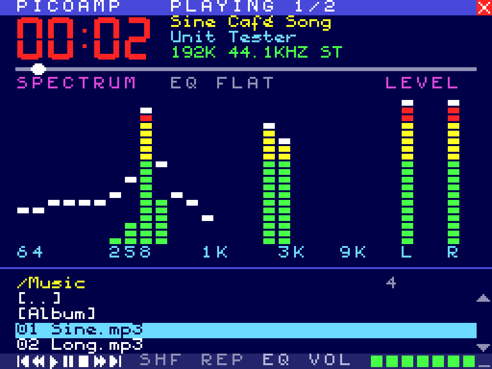
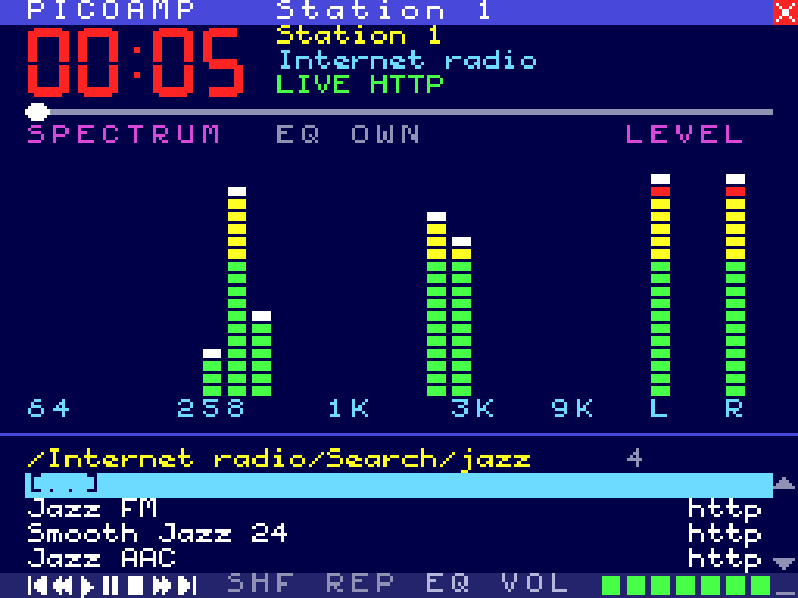
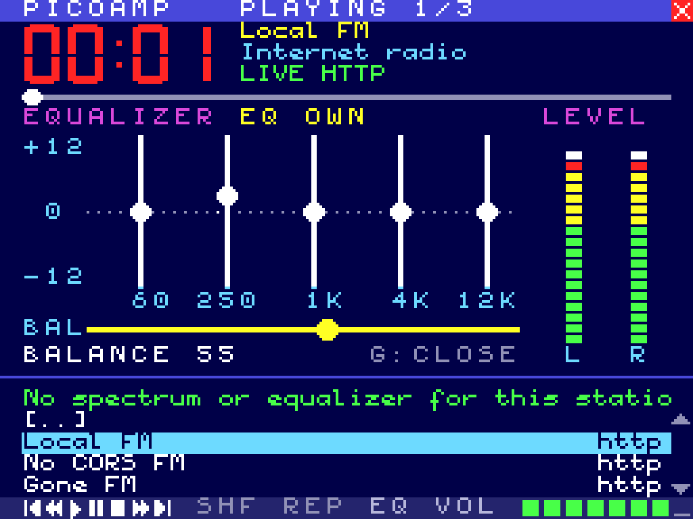
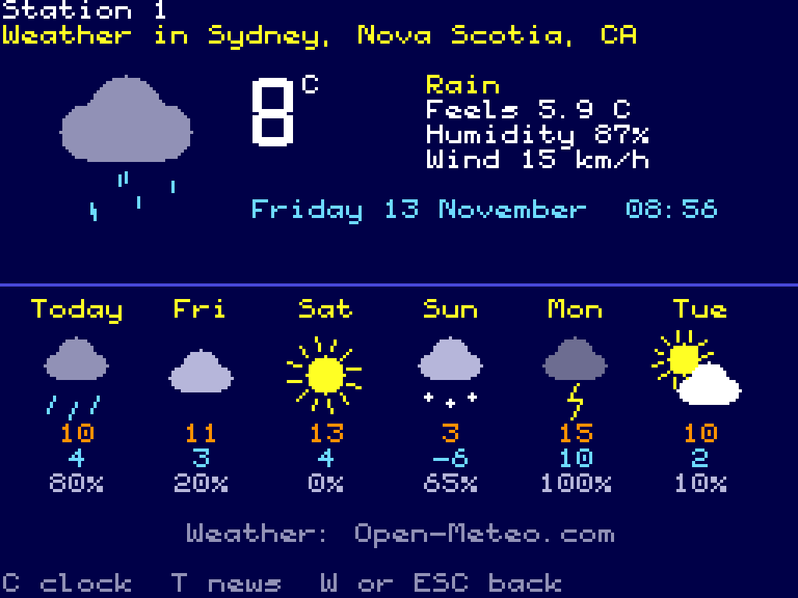

# PicoAmp for the web

[PICOAMP](https://github.com/Jzzy-dev/msx-picoplay-picoamp), the MSX2 music and internet radio player
for the PicoVerse 2350 cartridge, in the browser. It is the same program as
[PicoAmp for Windows](https://github.com/Jzzy-dev/win-picoamp): the C code that draws every page cell for
cell as on the MSX is compiled to WebAssembly, and the browser does the sound, the files and the web.

**Open it:** <https://jzzy-dev.github.io/web-picoamp/>. There is nothing to install, so there is no
SmartScreen, no admin rights and nothing for IT to approve. It runs in a recent Chrome, Edge, Firefox
or Safari, on a PC, a Mac, a Chromebook, Linux or a tablet.

| Playing | Internet radio: search | Equalizer (G) |
|---|---|---|
|  |  |  |
| **Clock (C)** | **Weather (W)** | **A picture (I)** |
|  |  |  |

*(The screenshots come from the tests, with their test music, stations and places.)*

## What it does

* **Your own music:** an entry at the top picks a folder (Chrome and Edge remember it between visits;
  other browsers ask again). Its folders and files are the list, with the title and artist from the
  ID3 tags. Plays MP3, WAV, FLAC, AAC/M4A, Ogg and Opus, whatever the browser itself plays.
  You can also drop music files on the page.
* **Internet radio:** your lists, Favourites, and the free [Radio Browser](https://www.radio-browser.info)
  directory (Top stations, Most voted, Trending now, By country, By genre, By decade, and `/` search).
  The directory only shows stations in codecs this browser plays. N and P go through the list's stations.
* **The picture:** the 24-band spectrum analyser, VU meters, oscilloscope (V), equalizer and balance (G),
  presets (E) and the full-screen pictures (Z). The analyser and equalizer are the PicoVerse Audio
  Engine's code; the equalizer's five bands are the browser's own filters.
* **The cover (V a third time),** as PICOAMP on the MSX shows it: 80×80 pixels in MSX SCREEN 4 cells
  (two colours in every 8 pixels of a row) with five palette entries of its own for each row of cells
  (as the MSX with engine 0.17; `rows = off` in the settings: five for all of it), 12 bars beside it.
  **Z** then **Cover** shows it big in MSX SCREEN 8 (256 × 192, 256 colours, dithered), as the MSX
  does: the track's own picture, the folder's, the one from the internet (iTunes covers at 600 × 600),
  the default pictures whole.
  It comes from the track's tag (MP3, FLAC), else from `cover`, `folder`, `front`, `album`,
  `albumart` or `AlbumArtSmall` (`.jpg`, `.jpeg`, `.png`) in its folder.
  A station shows its logo, found as the MSX engine finds it. Radio Browser is asked for the station
  by its directory id, else by its address, else by its exact name. The station's `favicon` is kept
  in the browser's cache, and "no logo" is kept too, so the next start asks nothing. Most logo
  servers do not let other pages read their pictures (CORS), and a page on https cannot fetch from
  http. Those logos come through the public image proxy [wsrv.nl](https://wsrv.nl/), which gets the
  logo's address and nothing else.
  The song that plays on a station, and a file without a picture (by its tags: artist and album,
  else artist and title), get their cover from the iTunes search, kept in the browser's cache too.
  A song's cover shows over the station's logo; a song without one shows the logo again. When
  nothing has a cover, one of three default pictures shows (Copacabana, New York, Amsterdam), a new
  one at random for each track or station.
  How many are kept: at most 100 logos and 200 covers. Past that, the ones shown longest ago go
  (down to 90 %). A "no logo" or "no cover" is asked again after 30 days. Other limits go in the
  address: `?keeplogos=50&keepcovers=400` (0: keep all).
* **Pictures (I):** pick a folder of pictures (Chrome and Edge remember it, as the music folder); its
  folders and pictures (anything the browser shows: JPEG, PNG, GIF, WebP, AVIF ...).
  * Enter shows one in MSX SCREEN 8 (256 × 192, 256 colours, fitted with the MSX's dot shape and
    dithered); Left/Right the one before or after, Space marks it, any other key goes back.
  * Space marks pictures (A all); **G** plays the marked ones, or all of the folder, as a slideshow.
  * **O** sets the screensaver (off, 1, 2, 5, 10, 15 or 30 minutes), **R** how long a picture shows
    (5 to 60 s), **U** shuffle, **F** makes this folder the screensaver's. "Choose another folder..." at
    the top picks another one.
  * The screensaver plays that folder's slideshow after the minutes without a key or a click, while the
    player shows; any key goes back. It needs the folder: in Chrome and Edge after a reload too (once
    the browser may read it again), in other browsers once it was picked in this visit.
* **Clock (C)** with sleep timer and alarm, and **Weather (W)** for the place of your internet connection
  ([GeoJS](https://www.geojs.io)) or a place found by name, from [Open-Meteo](https://open-meteo.com).
  * The alarm and sleep timer only work while the page is open (in a background tab is fine).
* **Media keys and the lock screen:** play/pause, next and previous work through the browser.
* **Any window size:** fit at 4:3 and sharp (whole-pixel enlargement, only the last step smoothed).
  F2 switches to whole multiples or stretch, F3 adds scan lines, and F11, Alt+Enter or a double click
  beside the picture goes full screen. **?** or **F1** (or the **?** box at the top right) shows all the keys.
* **The mouse:** click to choose, click again to play, right button goes back. The wheel scrolls the list; over **VOL** it sets the volume.
* **Your lists:** **O** opens an editor for the station lists. You can create, rename, delete and edit
  lists as `.m3u` text, and import or export `.m3u`/`.pls` files. You can also drop an `.m3u`/`.pls` file
  on the page. F adds a station to Favourites, D removes it, and Ctrl+Up/Down moves it.
  * The settings and lists stay in this browser (its local storage). Export a list to keep a copy.

## What the browser does not allow (yet)

A web page may only read another site when that site allows it (CORS). This has three effects:

* **Stations without CORS** still play, but as they are, without spectrum or equalizer. PicoAmp says so
  when it happens. Most stations (Icecast, SomaFM, Radio Paradise and others) do allow it.
* **http-only stations** cannot be played from an https page. PicoAmp says so.
* **Song titles of stations** (ICY) are inside the stream, which a page may not read. PicoAmp asks
  for them beside it, every 20 s, in the first way that answers: the station's own service (Triton
  Digital's for StreamTheWorld stations such as 538, Radio 10, Veronica; SomaFM; laut.fm; Zeno), its
  server's status page (Icecast, SHOUTcast), the stream's metadata where the server allows it (the NPO
  stations, many Icecast stations), and last [onlineradiobox.com](https://onlineradiobox.com)'s now
  playing, found by the station's name and country (Qmusic, Sky Radio and most big stations). In a live
  check of the 53 most listened https stations, 32 tell their song this way; the rest show their name.
* **The news (T)** is not in the web version: most feeds do not allow pages to read them.

A small relay of PicoAmp's own (for example a free Cloudflare Worker) would solve all four
(`npproxy=` gives the song titles' requests one). That is the
next step.

## Build and run

You need [wasi-sdk](https://github.com/WebAssembly/wasi-sdk) 25 (clang for WebAssembly) and Python 3.

```sh
make WASI_SDK=/path/to/wasi-sdk     # web/picoamp.wasm
make serve                          # http://localhost:8000
make test                           # the tests in headless Chromium (needs ffmpeg and playwright)
```

* `web/` is the whole site: `index.html`, `picoamp.js` (the page: picture, keys, sound, storage, files),
  `style.css` and `picoamp.wasm`.
* `src/` is the C program. Most of it is shared with PicoAmp for Windows. `web.c` is its link to the
  page, `audio_web.c` the player, `news_web.c` the news page's note.
* The services' addresses can be changed for tests: `?rb=…&meteo=…&geo=…&ipapi=…`.

**GitHub Pages:** the workflow builds, tests and publishes `web/`. In the repository's
Settings → Pages, set Source to *GitHub Actions* once.

## Licence

As PICOAMP and PicoAmp for Windows: see [LICENSE.txt](LICENSE.txt). The font comes from C-BIOS
(`third_party/cbios`, with its own licence).
