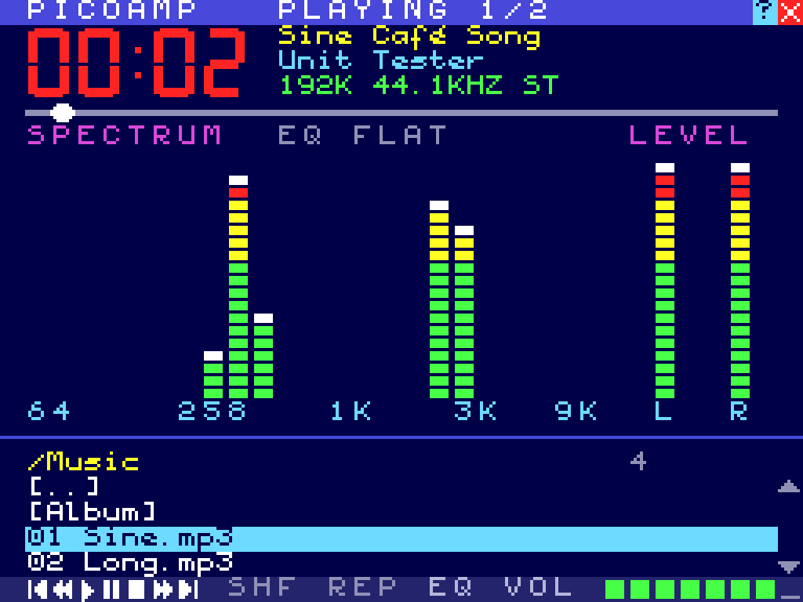
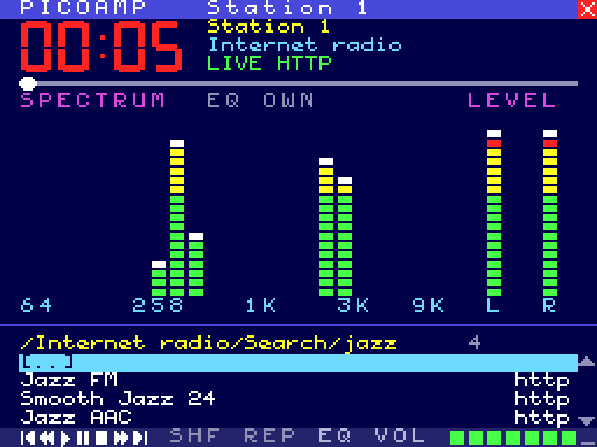
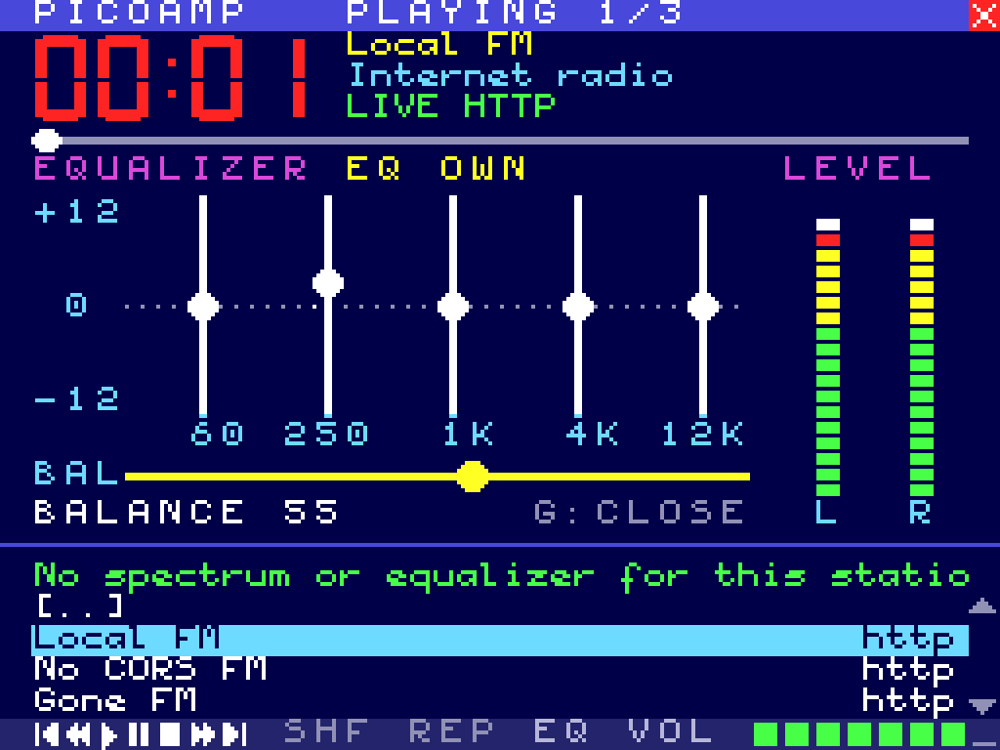
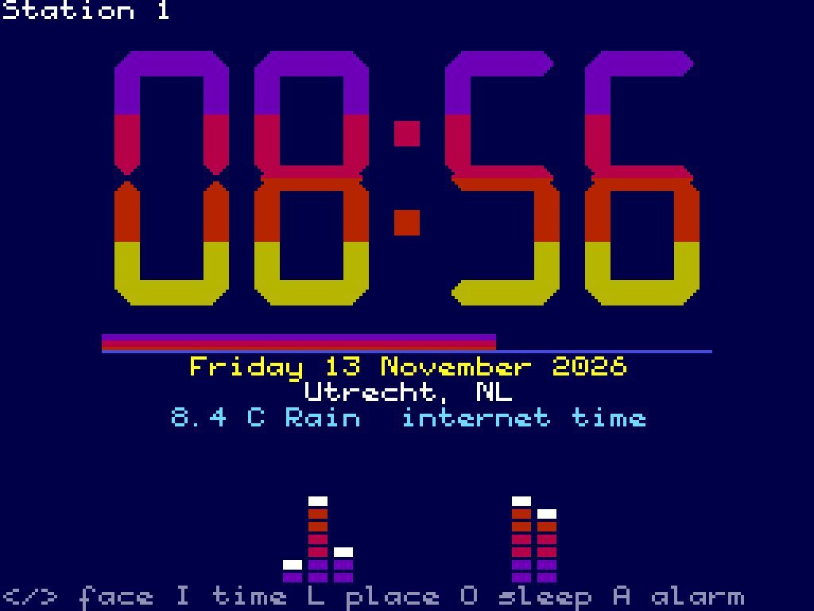
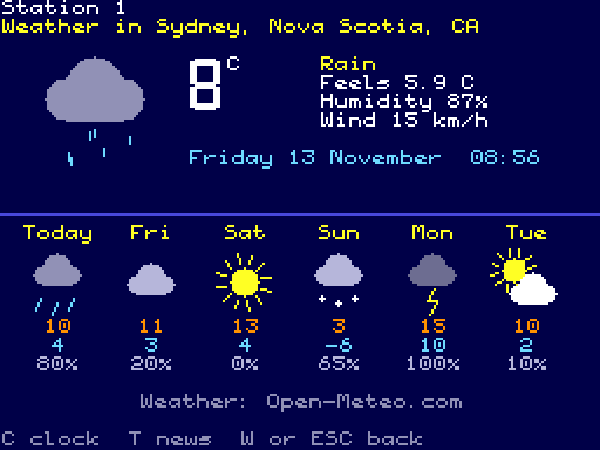

# PicoAmp for the web

[PICOAMP](https://github.com/Jzzy-dev/msx-picoplay-picoamp), the MSX2 music and internet radio player
for the PicoVerse 2350 cartridge, in the browser. It is the same program as
[PicoAmp for Windows](https://github.com/Jzzy-dev/win-picoamp): the C code that draws every page cell for
cell as on the MSX is compiled to WebAssembly, and the browser does the sound, the files and the web.

**Open it:** <https://jzzy-dev.github.io/web-picoamp/>. There is nothing to install, so there is no
SmartScreen, no admin rights and nothing for IT to approve. It runs in a recent Chrome, Edge, Firefox
or Safari, on a PC, a Mac, a Chromebook, Linux or a tablet.

| Playing | Internet radio: search | Equalizer (G) |
|---|---|---|
|  |  |  |
| **Clock (C)** | **Weather (W)** | |
|  |  | |

*(The screenshots come from the tests, with their test music, stations and places.)*

## What it does

* **Your own music:** an entry at the top picks a folder (Chrome and Edge remember it between visits;
  other browsers ask again). Its folders and files are the list, with the title and artist from the
  ID3 tags. Plays MP3, WAV, FLAC, AAC/M4A, Ogg and Opus, whatever the browser itself plays.
  You can also drop music files on the page.
* **Internet radio:** your lists, Favourites, and the free [Radio Browser](https://www.radio-browser.info)
  directory (Top stations, Most voted, Trending now, By country, By genre, By decade, and `/` search).
  The directory only shows stations in codecs this browser plays. N and P go through the list's stations.
* **The picture:** the 24-band spectrum analyser, VU meters, oscilloscope (V), equalizer and balance (G),
  presets (E) and the full-screen pictures (Z). The analyser and equalizer are the PicoVerse Audio
  Engine's code; the equalizer's five bands are the browser's own filters.
* **Clock (C)** with sleep timer and alarm, and **Weather (W)** for the place of your internet connection
  ([GeoJS](https://www.geojs.io)) or a place found by name, from [Open-Meteo](https://open-meteo.com).
  * The alarm and sleep timer only work while the page is open (in a background tab is fine).
* **Media keys and the lock screen:** play/pause, next and previous work through the browser.
* **Any window size:** fit at 4:3 and sharp (whole-pixel enlargement, only the last step smoothed).
  F2 switches to whole multiples or stretch, F3 adds scan lines, and F11, Alt+Enter or a double click
  beside the picture goes full screen. **?** or **F1** (or the **?** box at the top right) shows all the keys.
* **The mouse:** click to choose, click again to play, right button goes back. The wheel scrolls the list; over **VOL** it sets the volume.
* **Your lists:** **O** opens an editor for the station lists. You can create, rename, delete and edit
  lists as `.m3u` text, and import or export `.m3u`/`.pls` files. You can also drop an `.m3u`/`.pls` file
  on the page. F adds a station to Favourites, D removes it, and Ctrl+Up/Down moves it.
  * The settings and lists stay in this browser (its local storage). Export a list to keep a copy.

## What the browser does not allow (yet)

A web page may only read another site when that site allows it (CORS). This has three effects:

* **Stations without CORS** still play, but as they are, without spectrum or equalizer. PicoAmp says so
  when it happens. Most stations (Icecast, SomaFM, Radio Paradise and others) do allow it.
* **http-only stations** cannot be played from an https page. PicoAmp says so.
* **Song titles of stations** (ICY) cannot be read, so a station shows its name instead.
* **The news (T)** is not in the web version: most feeds do not allow pages to read them.

A small relay of PicoAmp's own (for example a free Cloudflare Worker) would solve all four. That is the
next step.

## Build and run

You need [wasi-sdk](https://github.com/WebAssembly/wasi-sdk) 25 (clang for WebAssembly) and Python 3.

```sh
make WASI_SDK=/path/to/wasi-sdk     # web/picoamp.wasm
make serve                          # http://localhost:8000
make test                           # the tests in headless Chromium (needs ffmpeg and playwright)
```

* `web/` is the whole site: `index.html`, `picoamp.js` (the page: picture, keys, sound, storage, files),
  `style.css` and `picoamp.wasm`.
* `src/` is the C program. Most of it is shared with PicoAmp for Windows. `web.c` is its link to the
  page, `audio_web.c` the player, `news_web.c` the news page's note.
* The services' addresses can be changed for tests: `?rb=…&meteo=…&geo=…&ipapi=…`.

**GitHub Pages:** the workflow builds, tests and publishes `web/`. In the repository's
Settings → Pages, set Source to *GitHub Actions* once.

## Licence

As PICOAMP and PicoAmp for Windows: see [LICENSE.txt](LICENSE.txt). The font comes from C-BIOS
(`third_party/cbios`, with its own licence).
